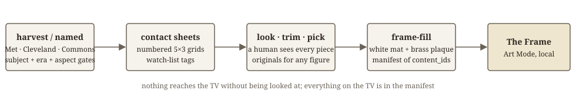

# frame-curator

A hand-vetted, family-safe public-domain art gallery for **Samsung The Frame**, with no Art Store subscription
and no cloud. Harvest open-access paintings from museum APIs, look at every one of them on numbered contact sheets,
approve the ones you want, and upload only those, each fitted whole onto the panel with a white gallery mat and an
engraved brass plaque. A manifest records exactly what is on the TV so any piece can be traced and removed.



## Why

The obvious way to fill a Frame with "famous art" is to scrape a museum API for the Western canon. That canon is
full of beheadings, martyrdom, blood and nudity, and two of those ended up on a living-room wall in front of small
children (an Expressionist nude and *Head of Saint John the Baptist* on a platter). Search terms cannot fix that:
Impressionist searches return *Bathers*, Old-Master searches return *Judith and Holofernes*, and metadata gates leak.

So this tool is built around one rule: **nothing goes on the TV that a human has not looked at**, and every upload is
written to a manifest. The gates (subject, era, orientation) exist to shrink the pile you have to look at, not to
replace looking.

## What it does

1. **Harvest** gated candidates at full resolution from The Met and the Cleveland Museum of Art (public domain /
   CC0, European paintings, landscape orientation, serene subjects only), or from an **explicit named list** of works
   (Met / Cleveland object ids and Wikimedia Commons files, e.g. `lists/americana.json`).
2. **Contact sheets**: every candidate on a numbered 5×3 grid with artist, title, date and a watch-list tag when the
   museum's own subject tags mention figures, bathers, children. You look at every sheet; for anything with figures
   you open the original.
3. **Trim** museum "on the easel" photos to the canvas (black surround, easel clips, colour-calibration strips).
   Tight museum crops are left untouched.
4. **Pick / drop** by candidate number. Approved entries go to `frame_gallery.json`.
5. **Fill**: upload only the approved gallery (white mat, bevel line, brass plaque with artist / title, date),
   clear the TV first unless `--keep`, and write `frame_uploads.json` (content_id → artist, title, date, source,
   image URL, sha1). Re-selects the first piece at the end.

## Install

```bash
git clone https://github.com/jaselton/frame-curator
cd frame-curator
uv sync                      # or: pip install -e .
cp .env.example .env         # set FRAME_TV_HOST and FRAME_TV_MAC
```

Python 3.11+. Tested on a 2019 65" Frame (QN65LS03RA) over its local art websocket (port 8002) via
[samsungtvws](https://github.com/xchwarze/samsung-tv-ws-api). Newer Frames should work; report what you find.

## Quick start

```bash
uv run frame-setup                      # pair once (tap Allow on the TV) and put a small starter set up
uv run frame-curate harvest --target 160
# open data/frame_sheets/sheet-*.jpg and look at every thumbnail
uv run frame-curate trim                # clean up the museum photos
uv run frame-curate pick 1-12,15,20-30  # approve
uv run frame-curate drop 3,4            # reject
uv run frame-curate status              # counts + the watch-list hits you should open at full size
uv run frame-fill                       # clear the TV and upload the approved gallery
```

Add a named list later without clearing the TV:

```bash
uv run frame-curate named lists/americana.json --theme americana
# look at the new sheets, pick, then
uv run frame-fill --keep
```

Remove one piece: `frame-curate drop <n>` then `frame-fill` (clear + re-upload), or delete its content_id with
`FrameTV(host).delete([...])` using the manifest.

## One piece a day

The Frame's own auto-rotation is a relative timer (every N minutes since it was switched on) and cannot be anchored
to a time of day. `frame-rotate` is the alternative: run it from launchd or cron at midnight and it shows the next
piece from a persisted shuffle of the manifest. If somebody picked a piece with the remote, that piece stays for the
rest of the day and the next day (the first midnight after a manual change is skipped). `--dry-run` explains what it
would do; `--now` rotates immediately; `--date YYYY-MM-DD` pretends it is another day for testing.

A **picture-study term** overrides everything: put `collections/picture_study.json` in the data dir with
`{"pieces": [{"ref": "cma:125013", "from": "2026-10-19", "to": "2026-11-01"}, ...]}` and the scheduled piece holds the
wall for its whole window, weekends included, outranking both the daily rotation and the manual hold. Nothing else
advances while it is up.

```bash
uv run frame-rotate --dry-run
# cron (Linux / a Pi):
0 0 * * *  cd /path/to/frame-curator && /path/to/uv run frame-rotate >> data/frame_rotate.log 2>&1
```

macOS launchd (`~/Library/LaunchAgents/com.example.frame-rotate.plist`): `ProgramArguments` = `uv run --directory
/path/to/frame-curator frame-rotate`, `StartCalendarInterval` = `{Hour: 0, Minute: 0}`, `RunAtLoad` = false, then
`launchctl bootstrap gui/$(id -u) <plist>`. Keep the TV's own rotation off so the piece holds all day.

## The rules the gates encode

See [docs/curation-rules.md](docs/curation-rules.md). In short: allowed are Monet gardens and water lilies,
Impressionist landscapes and city scenes, Dutch and Barbizon landscapes and seascapes, flower and fruit still lifes,
architecture, horses and countryside, calm pastoral and genre scenes. Hard-excluded are religious narrative and
martyrdom, any beheading, battles and soldiers, all mythology (it carries the nudity), any nude even in the
background, modern and avant-garde work, and anything frightening: fires, shipwrecks, dead animals.

For an owner-chosen named list the military exclusion is waived (that is how *Washington Crossing the Delaware*
gets in) while nudity, gore and death stay excluded; an entry can set `"allow": true` to skip the text gate entirely.
Everything is still eyeballed.

## Sources and their quirks

- **The Met** open-access API: v1 search was retired on 2026-10-01; this uses `v1.1/search` (paginated, department
  filter works). The Met throttles bursts with 403; the harvester paces itself.
- **Cleveland Museum of Art** open-access API: CC0, generous, print-size images around 3400 px, and it holds the
  Currier & Ives lithographs.
- **Art Institute of Chicago**: the API works but the IIIF image server sits behind a Cloudflare browser challenge,
  so images do not download from scripts. Metadata-only for now.
- **Wikimedia Commons** (named lists only): `upload.wikimedia.org` throttles scripted downloads of originals (429),
  so the tool fetches through `Special:FilePath/<file>?width=…`, which serves up to about 3840 px. License is checked
  (public domain / CC0 only).
- The 2019 Frame closes ports 8001/8002 in Art-Mode deep sleep; a Wake-on-LAN packet brings them back. Its upload
  storage tops out around 227 pieces. The art websocket's `clientConnect` handshake fails spuriously; calls retry.

## Layout

```
frame_curator/art.py      sources, gates, mat + plaque rendering, FrameTV controller, manifest
frame_curator/curate.py   harvest / named / sheets / trim / pick / drop / status
frame_curator/fill.py     upload the approved gallery, keep the manifest
frame_curator/setup.py    one-time pairing + starter set
frame_curator/rotate.py   one piece a day at midnight, with a two-day hold after a manual pick
lists/americana.json      an example named list (history, Hudson River School, the West, Currier & Ives)
data/                     (git-ignored) candidates, sheets, gallery, manifest, pairing token
```

## Contributing

Issues and PRs welcome, especially: results on newer Frame models, more open-access sources with CC0 images,
and better subject gates. Please do not send PRs that weaken the hard-exclude list; add to it.

MIT © 2026 John Aselton
